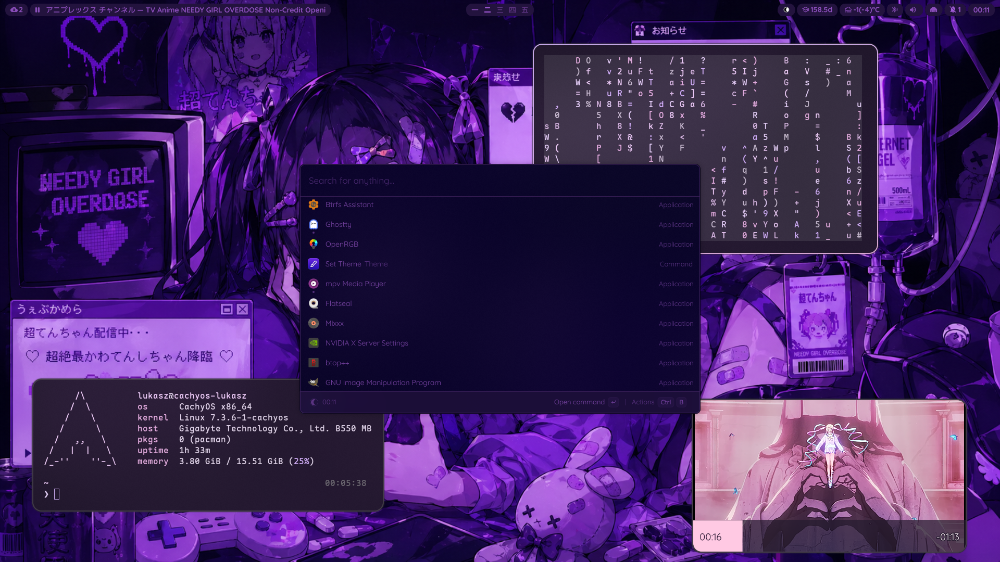

# Łukasz Ciszewski' dotfiles 📜

Config for my awesome hyprland setup on [CachyOS](https://cachyos.org/).


## Requirements

Ensure you have the following installed on your system

### Git

```
pacman -S git
```

### Stow

```
pacman -S stow
```

## Installation

First, check out the dotfiles repo in your $HOME directory using git

```
$ git clone https://github.com/lciszewski27/dotfiles.git ~/dotfiles
$ cd ~/dotfiles
```

then use GNU stow to create symlinks (stow dir = `~/dotfiles`, target = `~`):

```
$ stow .
```

Managed (important only, local-first):
- shell+git: `.zshrc` `.bashrc` `.bash_profile` `.p10k.zsh` `.zprofile` `.gitconfig`
- terminal+editor: `.config/ghostty` `.config/nvim` `.config/fastfetch` `.config/btop` `.config/yazi` `.config/zed` `.config/matugen`
- hyprland: `.config/hypr` `.config/waybar` `.config/wlogout` `.config/dunst` `.config/nwg-look` `.config/quickshell`

Ignored by stow (`.stow-local-ignore`): `.git` `README.md` `desktop.png` `hyprland.list`
Ignored by git (`.gitignore`, stowed locally but not committed): `Fonts/*.ttf/*.otf`, `waybar-modules` binary, `*.bak*`, `secrets.env`, nested `nvim/.git`.

### Local files win (don't overwrite with old repo version)

If you already have configs in `~`, adopt them into the repo instead of overwriting:

```
$ cd ~/dotfiles
$ stow --adopt .
$ git diff  # review: locals should have overwritten repo versions
$ git add -A && git commit -m "adopt locals"
```

Your pre-stow files are backed up to `~/dotfiles-backup-YYYY-MM-DD/` when set up with this workflow.
Fresh machine with empty `~`: plain `stow .` is enough.
